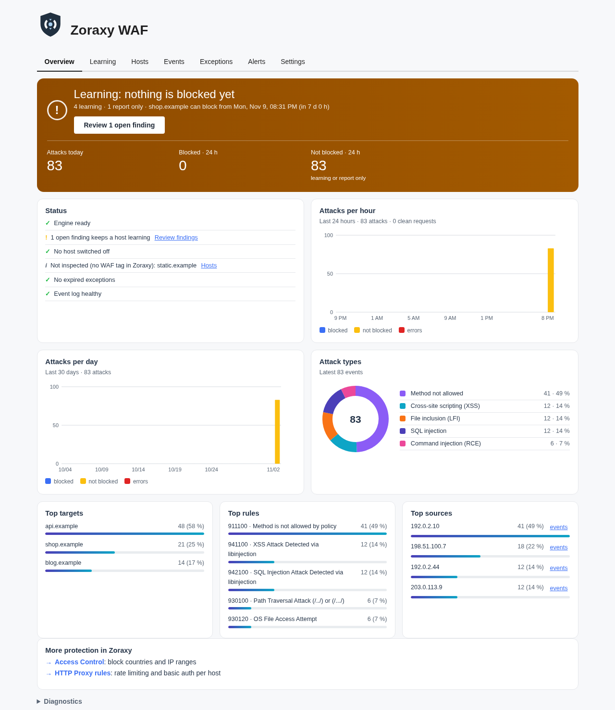
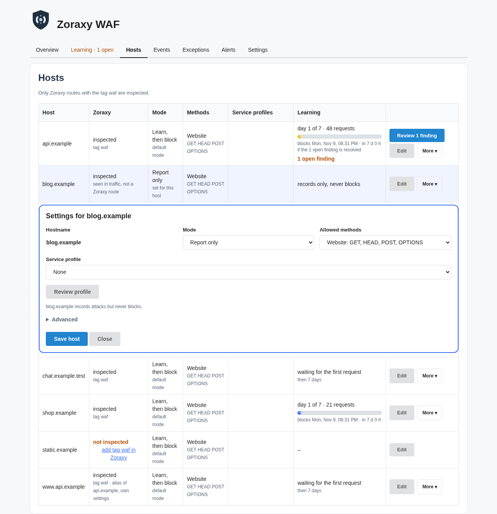
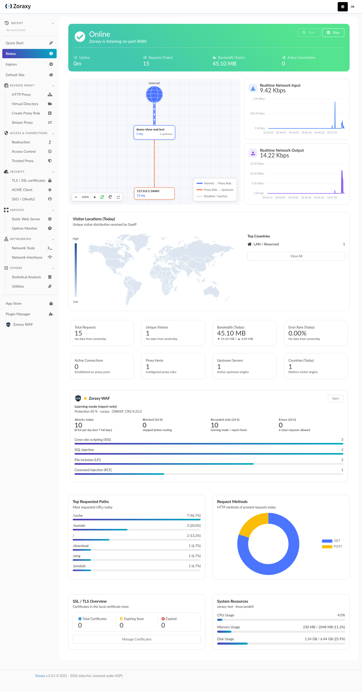
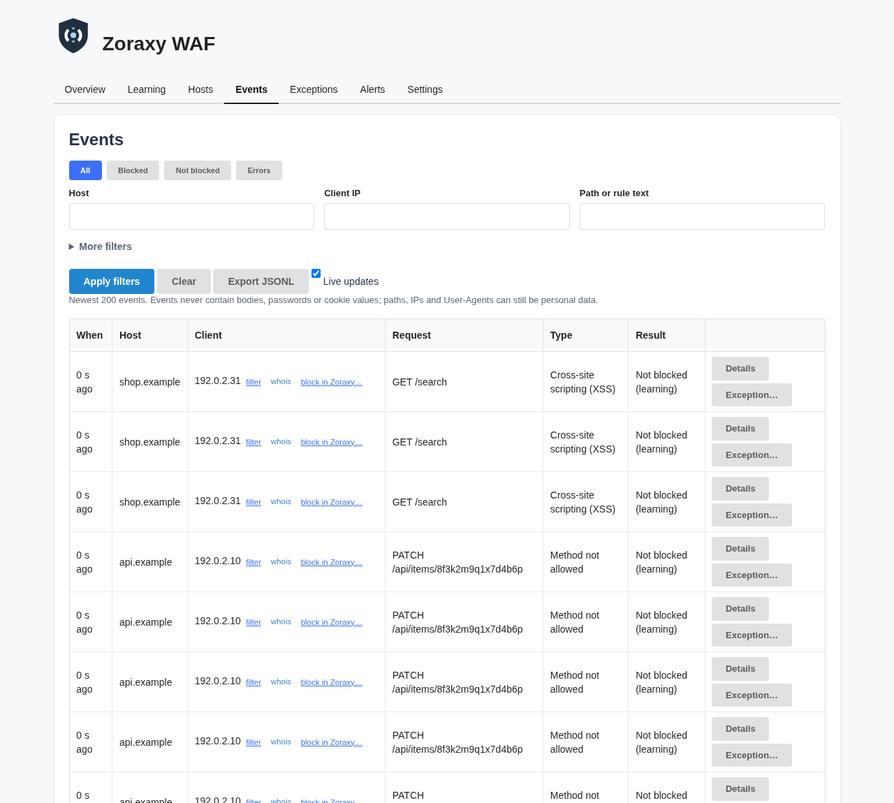

# Zoraxy WAF

A web application firewall for [Zoraxy](https://github.com/tobychui/zoraxy), as a plugin.
Coraza + OWASP Core Rule Set, embedded – no external service, no rule downloads.
Every request is inspected before Zoraxy routes it; attacks get a 403, clean traffic continues untouched.

## What you get

- **Learns first, then blocks on its own.** After installing, the WAF can only be switched on with a learning period (7 days by default, adjustable) or, at your own risk, with blocking right away. Each host learns from its first request and switches to blocking when its period is over and no finding points at your real users. Hosts you add later learn first, too. Findings recorded in report mode carry over when you switch to learning; the period itself starts again.
- **Your hosts, straight from Zoraxy.** The host list is read from Zoraxy's HTTP proxy rules (read-only plugin API), including aliases, and shows which routes are inspected and which are not.
- **Methods per host.** Websites keep the OWASP default (GET, HEAD, POST, OPTIONS). Web apps with an API get PUT, PATCH and DELETE on their host only, suggested by the plugin after it saw them a few times. Never globally.
- **Scoped exceptions.** A false positive becomes an exception for exactly that rule, host and path, with an expiry – one click from the event.
- **Dashboard in Zoraxy's style.** Attacks per hour and day, attack types, top targets, rules and sources, protection checklist. A compact card for Zoraxy's own Status page is ready as well; it shows up once Zoraxy can render plugin status cards (a separate, small core change I still have to propose).
- **Change history with restore.** Every saved revision shows what changed; any earlier revision can be restored.
- **Alerts, if you want them.** Attack bursts, engine health and expiring exceptions to a JSON webhook or a Mattermost/Slack hook. Off by default and free when off.
- **Speed setting with measured numbers.** Trade RAM for throughput; the table in the UI shows what each level costs and gains (same rules, same decisions).

## Requirements

The plugin uses Zoraxy's dynamic capture sniffer with two small additions that are on their way upstream:

- a sniffer can deny a request, logged with a short reason – [tobychui/zoraxy#1353](https://github.com/tobychui/zoraxy/pull/1353)
- a sniffer can ask for a bounded body prefix in its introspect (`dynamic_capture_sniff_body_kb`) – proposed in [discussion #1350](https://github.com/tobychui/zoraxy/discussions/1350)

Until both are merged, build Zoraxy from the branch [`pr/sniff-body`](https://github.com/BerziOnline/zoraxy/tree/pr/sniff-body). Without the body prefix the plugin inspects headers only and says so on its overview.

## Install

1. Download `zoraxy-waf-plugin` from the releases page (or build it, see below).
2. Put it into `<zoraxy>/plugins/zoraxy-waf/zoraxy-waf-plugin` and make it executable.
3. Enable **Zoraxy WAF** in Plugin Manager and open it from the sidebar.
4. Start the learning period on the overview. Resolve open findings on the *Learning* tab (allow a method, add an exception, or mark it as an attack); each host then blocks on its own.

Everything is configured in the plugin UI (authenticated Zoraxy session, CSRF-checked). State lives in `<plugin dir>/data/`: config, change history, 30-day counters and redacted events (no bodies, passwords or cookie values).

## Build

    go build -tags no_fs_access -o zoraxy-waf-plugin .

`no_fs_access` is required: it keeps Coraza from spooling request bodies to disk; the plugin refuses to start without it.

## Updates

Coraza and the OWASP Core Rule Set are Go dependencies pinned in `go.mod` (the versions are shown in the UI). A new rule set means a new plugin release – nothing is fetched at runtime.

## Service profiles

Profiles suggest app methods and curated rule exceptions from repeated login-bearing traffic and read-only route hints. Nothing is applied automatically. **Review profile** lists the changes; **Apply profile** makes one audited save. A manual selector is available in Hosts.

Mattermost includes field-scoped exceptions from observed false positives, Immich one for its mobile app's version check; authentik currently changes methods only. JSON exceptions expire after 366 days, use the existing expiry alerts and remain editable (**modified**). Removing a profile keeps method changes. Official CRS profiles are Coraza-only and exact-host scoped; [available packages and version handling](docs/SERVICE-PROFILES.md).

To add a profile, open a pull request with `profiles/<service>.json`, generic detection hints and redacted false-positive evidence. Every exception requires a method, narrow path, named field and reason; only protocol rules (920xxx) on one exact GET path may cover the whole request. The Go security gate sends command injection, PHP, remote file inclusion, SQLi, XSS and traversal payloads through every exception field. Each excluded rule must belong to the attack class its exception names, and the other classes must still block. Complete loss of a class requires an explicit `accepted_blind_spot` reason and review.

## Tests

    go test -tags no_fs_access ./...
    PLAYWRIGHT_MODULE=/path/to/node_modules/playwright node tests/run_ui_smoke.cjs   # browser journey

## Good to know

- Failure policy defaults to fail-open; choose fail-closed per host where traffic must be rejected when inspection fails. The core keeps the last approved policy across plugin crashes and restarts.
- Body inspection is bounded (prefix size and timeout are settings). Longer bodies are inspected up to the limit and let through with partial coverage; rejecting them instead is a setting. Zoraxy reads the prefix size when it starts: after raising it, restart Zoraxy (the overview reminds you).
- A finding is *open* when the requests the rules would block carried a login (cookie, Authorization or a token header) – most likely from one of your users. Findings without a login are treated as scanners and do not hold a host back. Only header names are used for this, never values.
- Learning, methods and findings work per hostname, the identity Zoraxy's dynamic capture hands to plugins (it sends no route ID). An alias learns on its own.
- The host list needs the plugin's read-only API permission; Zoraxy hands over only its port, so the plugin tries loopback first and then this machine's own addresses (for a web UI bound to one LAN address). Zoraxy reads plugin permissions only when it starts, so restart Zoraxy once after installing or updating the plugin; until then the list shows hosts from traffic.
- Request phases only: no response-body inspection, no brute-force detection by failed logins, no malware or file scanning. WebSocket handshakes are inspected, frames after the upgrade are not.
- Rate limiting, IP and country blocking live in Zoraxy itself and are linked from the overview rather than duplicated.
- CrowdSec AppSec is available as an alternative engine but not installed by this plugin; it needs a separately managed AppSec service.

## License

AGPL-3.0, the same license as Zoraxy. Coraza and the OWASP Core Rule Set are Apache-2.0 (see `THIRD_PARTY_NOTICES.txt`).

## Contact

Issues and ideas: [GitHub issues](https://github.com/BerziOnline/zoraxy-waf/issues).
