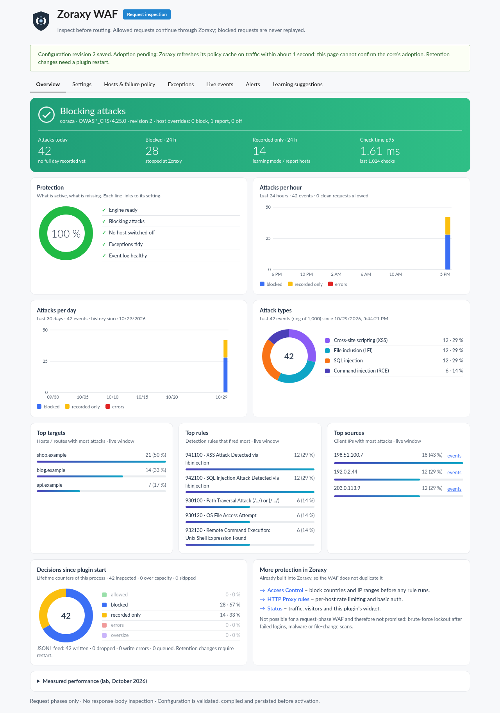
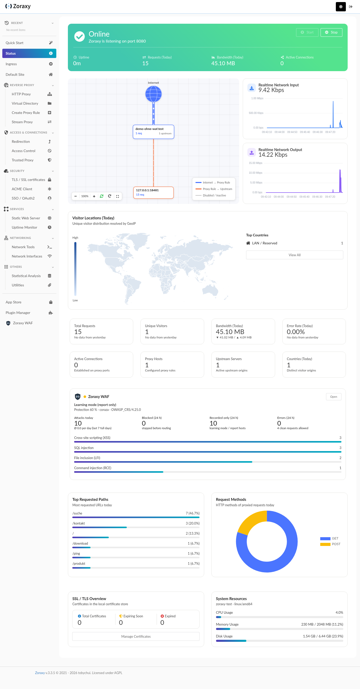
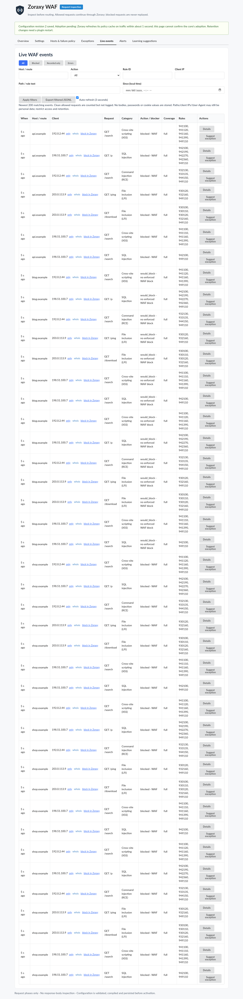

# Zoraxy WAF

A web application firewall for [Zoraxy](https://github.com/tobychui/zoraxy), as a plugin.
Coraza + OWASP Core Rule Set, embedded – no external service, no rule downloads.
Every request is inspected before Zoraxy routes it; attacks get a 403, clean traffic continues untouched.

## What you get

- **Learning mode first.** Report-only records what the rules would hit on your sites without blocking anything. Switch to block per host when you are happy.
- **Scoped exceptions.** A false positive becomes an exception for exactly that rule, host and path, with an expiry – one click from the event.
- **Dashboard in Zoraxy's style.** Attacks per hour and day, attack types, top targets, rules and sources, protection checklist. A compact card on Zoraxy's own Status page.
- **Change history with restore.** Every saved revision shows what changed; any earlier revision can be restored.
- **Alerts, if you want them.** Attack bursts, engine health and expiring exceptions to a JSON webhook or a Mattermost/Slack hook. Off by default and free when off.
- **Speed setting with measured numbers.** Trade RAM for throughput; the table in the UI shows what each level costs and gains (same rules, same decisions).

## Requirements

Zoraxy with the request inspection hook for router plugins – [tobychui/zoraxy#1349](https://github.com/tobychui/zoraxy/pull/1349).
Until that is merged, the plugin needs a Zoraxy build from that branch.

## Install

1. Download `zoraxy-waf-plugin` from the releases page (or build it, see below).
2. Put it into `<zoraxy>/plugins/zoraxy-waf/zoraxy-waf-plugin` and make it executable.
3. Enable **Zoraxy WAF** in Plugin Manager and open it from the sidebar.
4. Start with *Report only*, watch Live events for a day, then set *Block* – globally or per host.

Everything is configured in the plugin UI (authenticated Zoraxy session, CSRF-checked). State lives in `<plugin dir>/data/`: config, change history, 30-day counters and redacted events (no bodies, passwords or cookie values).

## Build

    go build -tags no_fs_access -o zoraxy-waf-plugin .

`no_fs_access` is required: it keeps Coraza from spooling request bodies to disk; the plugin refuses to start without it.

## Updates

Coraza and the OWASP Core Rule Set are Go dependencies pinned in `go.mod` (the versions are shown in the UI). A new rule set means a new plugin release – nothing is fetched at runtime.

## Tests

    go test -tags no_fs_access ./...
    PLAYWRIGHT_MODULE=/path/to/node_modules/playwright node tests/run_ui_smoke.cjs   # browser journey

## Good to know

- Failure policy defaults to fail-open; choose fail-closed per host where traffic must be rejected when inspection fails. The core keeps the last approved policy across plugin crashes and restarts.
- Body inspection is bounded (prefix size and timeout are settings); oversized bodies in block mode are rejected, not skipped.
- Request phases only: no response-body inspection, no brute-force detection by failed logins, no malware or file scanning. WebSocket handshakes are inspected, frames after the upgrade are not.
- Rate limiting, IP and country blocking live in Zoraxy itself and are linked from the overview rather than duplicated.
- CrowdSec AppSec is available as an alternative engine but not installed by this plugin; it needs a separately managed AppSec service.

## License

AGPL-3.0, the same license as Zoraxy. Coraza and the OWASP Core Rule Set are Apache-2.0 (see `THIRD_PARTY_NOTICES.txt`).

## Contact

Issues and ideas: [GitHub issues](https://github.com/BerziOnline/zoraxy-waf/issues).
